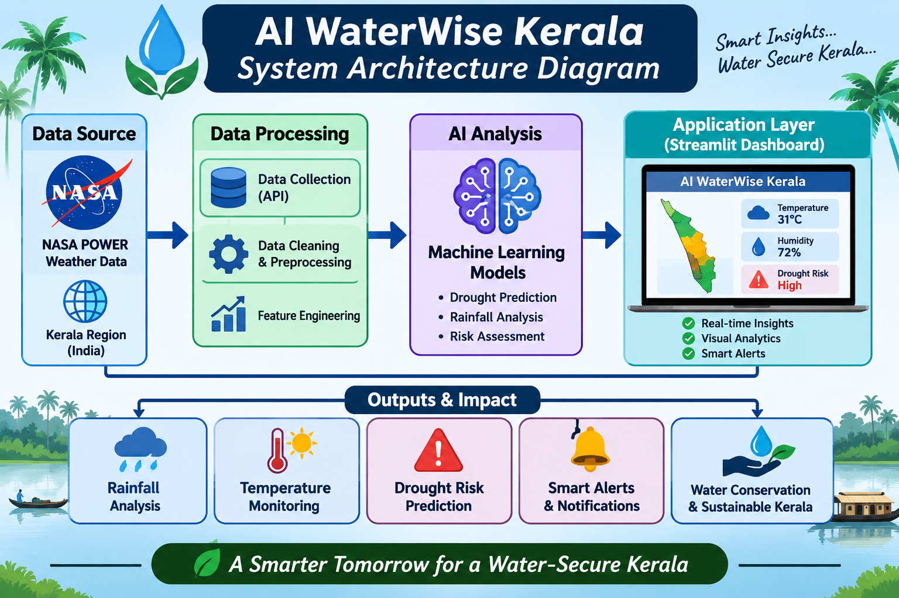
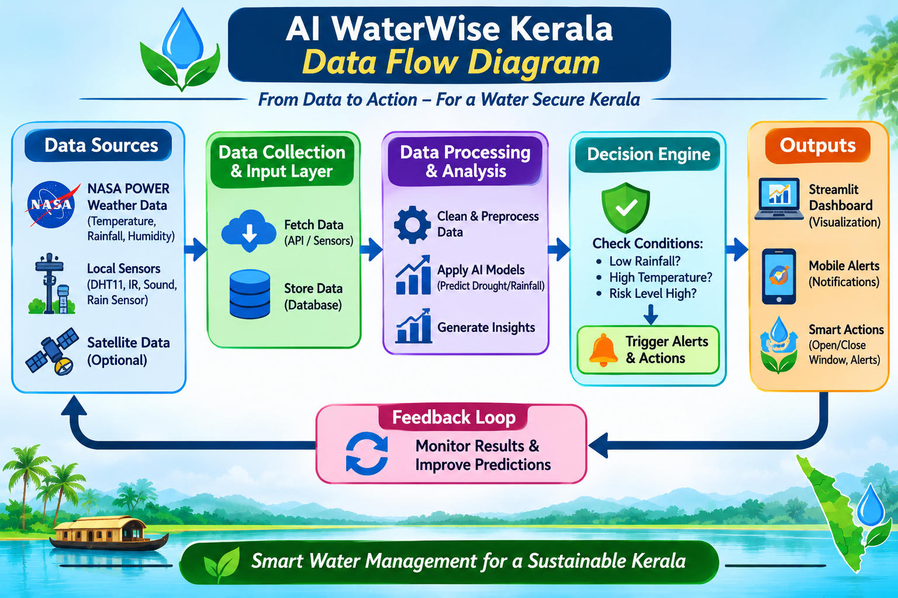
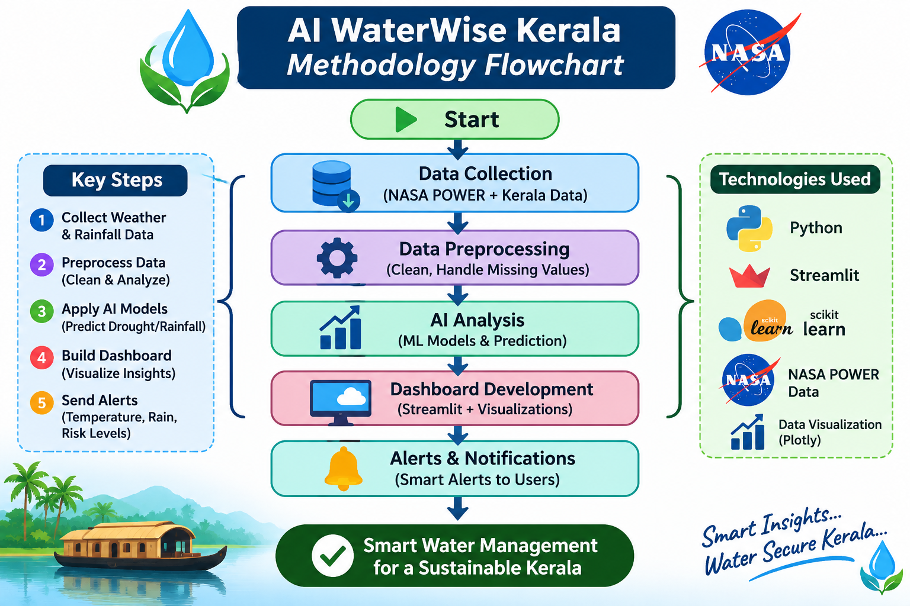
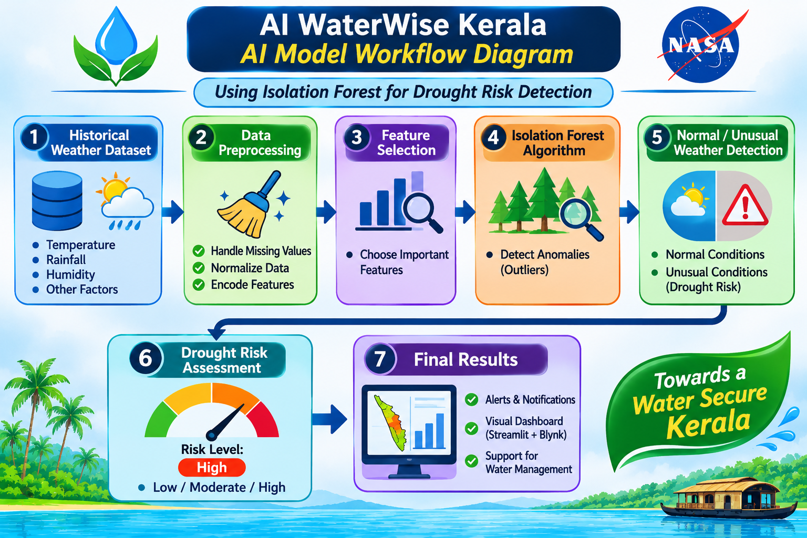

# 🌱 AI WaterWise Kerala

### NASA-Based AI Farming, Water Management and Environmental Monitoring System

## 🌍 Introduction

AI WaterWise Kerala is an AI-powered environmental monitoring and smart farming support system developed using NASA POWER satellite-based weather data.

The project analyzes historical rainfall and temperature patterns across 14 districts of Kerala to identify unusual weather conditions and assess potential drought risks.

Using Artificial Intelligence and data visualization, the system provides district-wise weather insights, drought risk categories, and useful recommendations for farmers.

The main aim of this project is to support sustainable agriculture, better water management, and climate resilience in Kerala.

## ❗ Problem Statement

Climate change and irregular rainfall patterns create challenges for agriculture and water management in Kerala.

Farmers may face difficulties in understanding changing rainfall patterns, unusual temperature conditions, and possible dry periods.

There is a need for an accessible system that uses historical environmental data to identify unusual weather patterns and provide useful information for better agricultural planning.

## 🎯 Objectives

- To analyze historical rainfall and temperature data across 14 districts of Kerala.
- To utilize NASA POWER data for environmental monitoring.
- To identify unusual weather patterns using Artificial Intelligence.
- To assess potential drought risks based on rainfall anomalies.
- To provide useful recommendations for farmers.
- To support sustainable agriculture and efficient water management.
- To develop an interactive dashboard for district-wise weather analysis.

## ✨ Key Features

- **14 Kerala Districts:** District-wise environmental data analysis.
- **NASA POWER Data:** Uses NASA satellite-based weather data.
- **AI Anomaly Detection:** Identifies unusual weather patterns using the Isolation Forest algorithm.
- **Drought Risk Assessment:** Estimates potential drought risk using rainfall anomalies and AI results.
- **Weather Visualization:** Displays rainfall and temperature charts.
- **Farmer Recommendations:** Provides useful suggestions based on weather conditions.
- **Interactive Dashboard:** Allows users to select districts and years for analysis.

## 💻 Technologies Used

- **Python:** Main programming language.
- **Google Colab:** Data analysis and model development.
- **Pandas:** Data cleaning and processing.
- **NumPy:** Numerical calculations.
- **Scikit-learn:** AI anomaly detection using Isolation Forest.
- **Streamlit:** Interactive web application development.
- **Plotly:** Interactive charts and visualizations.
- **NASA POWER API:** Historical rainfall and temperature data.
- **GitHub:** Project code and version control.

## 🛰️ NASA Data Source

This project uses historical weather data from **NASA POWER (Prediction Of Worldwide Energy Resources)**.

NASA POWER provides environmental data such as:
- Rainfall (Precipitation)
- Temperature
- Other meteorological parameters

The collected data is used to analyze rainfall and temperature patterns across 14 districts of Kerala.

**Official NASA POWER Website:**  
https://power.larc.nasa.gov/

## ⚙️ Methodology

The project follows these steps:

1. **Data Collection:** Collect historical rainfall and temperature data from NASA POWER API for 14 districts of Kerala.

2. **Data Preprocessing:** Clean and organize the collected weather data using Python and Pandas.

3. **Monthly Data Analysis:** Calculate monthly rainfall and temperature values.

4. **AI Anomaly Detection:** Apply the Isolation Forest algorithm to identify unusual weather patterns.

5. **Rainfall Anomaly Analysis:** Compare rainfall values with historical patterns to identify rainfall deviations.

6. **Drought Risk Assessment:** Estimate potential drought risk using rainfall anomalies and AI detection results.

7. **Farmer Recommendations:** Generate useful recommendations based on the identified weather conditions.

8. **Dashboard Development:** Display the results through an interactive Streamlit dashboard.

## 🏗️ System Architecture

The system follows a simple workflow to analyze environmental data and provide useful information to farmers.

### Working Flow

NASA POWER API  
⬇️  
Weather Data Collection  
⬇️  
Data Preprocessing  
⬇️  
Monthly Rainfall and Temperature Analysis  
⬇️  
Isolation Forest Anomaly Detection  
⬇️  
Drought Risk Assessment  
⬇️  
Farmer Recommendations  
⬇️  
Interactive Streamlit Dashboard

### Architecture Description

1. NASA POWER API provides historical weather data.
2. Python processes and organizes the collected data.
3. The AI model identifies unusual weather patterns.
4. The drought risk assessment module estimates potential dry conditions.
5. Farmer recommendations are generated based on the analysis.
6. Streamlit displays the results through an interactive dashboard.

## 🤖 AI Model Explanation

This project uses the **Isolation Forest algorithm**, an unsupervised machine learning technique.

### How It Works

1. The model receives historical rainfall and temperature data.
2. It analyzes patterns in the collected weather data.
3. It identifies unusual weather conditions (anomalies).
4. The detected anomalies are used in the drought risk assessment process.

### Why Isolation Forest?

- Suitable for detecting unusual data patterns.
- Does not require manually labelled training data.
- Helps identify abnormal rainfall and temperature conditions.

**Note:** The model identifies unusual patterns in historical data. It does not predict future weather conditions.

## 🌵 Drought Risk Assessment

The system assesses potential drought risk by analyzing rainfall anomalies and AI anomaly detection results.

### Risk Categories

- **Normal:** Rainfall conditions do not indicate significant dryness.
- **Watch:** Unusual rainfall conditions require attention and monitoring.
- **Severe Dry Conditions:** Significant rainfall deficiency combined with unusual weather patterns.

### Assessment Process

1. Analyze monthly rainfall values.
2. Calculate rainfall anomalies.
3. Check the AI anomaly detection results.
4. Apply prototype rules to estimate drought risk.
5. Display the risk category on the dashboard.

**Note:** These categories are experimental prototype assessments and are not official drought warnings.

## 📊 Results and Output

The system analyzes historical rainfall and temperature data from 14 districts of Kerala.

The dashboard provides:

- District-wise rainfall analysis.
- Monthly temperature analysis.
- AI-based unusual weather pattern detection.
- Drought risk classification.
- Farmer recommendations.
- Interactive charts and visualizations.

Users can select a district and year to explore the corresponding environmental data and analysis results.

The results are displayed through an interactive Streamlit dashboard.

## ⚠️ Limitations

- The analysis uses one representative geographical coordinate for each district, not measurements from every location in the district.
- NASA POWER data is historical and does not represent real-time local weather conditions.
- The Isolation Forest model identifies unusual patterns but does not forecast future weather.
- Drought risk categories are based on experimental prototype rules and are not official drought warnings.
- Data availability for 2026 may be incomplete.

## 🚀 Future Scope

The project can be improved further with the following features:

- **Weather Prediction:** Integrate advanced machine learning models to predict future weather conditions.
- **Improved AI Analysis:** Develop more accurate drought risk assessment models.
- **Real-Time Monitoring:** Integrate IoT-based weather sensors for real-time environmental data.
- **Mobile Application:** Develop a mobile app for farmers to access weather information.
- **Multilingual Alerts:** Provide recommendations and alerts in Malayalam and other regional languages.
- **Additional NASA Data:** Integrate more NASA Earth observation datasets for better environmental analysis.
- **Advanced Mapping:** Use geographical data to improve district-level environmental monitoring.

## 🌐 Live Website

Explore the AI WaterWise Kerala interactive dashboard:

[Click here to open AI WaterWise Kerala](https://ai-waterwise-nasa-hpjahyr7gbc3xglx796vk4.streamlit.app/)

The dashboard allows users to select Kerala districts and explore rainfall, temperature, AI anomaly detection, and drought risk assessment results.

## 📝 Conclusion

AI WaterWise Kerala is an environmental monitoring and smart farming support system developed using NASA POWER historical weather data and Artificial Intelligence.

The project analyzes rainfall and temperature patterns across 14 districts of Kerala and identifies unusual weather conditions using the Isolation Forest algorithm.

It also provides prototype drought risk assessments and useful recommendations for farmers through an interactive Streamlit dashboard.

This project aims to support sustainable agriculture, efficient water management, and better understanding of environmental changes in Kerala.

## ▶️ How to Run the Project

To run the AI WaterWise Kerala application, follow these steps:

1. Download or clone the project repository from GitHub.
2. Install Python on your computer.
3. Install the required Python libraries using:

   pip install -r requirements.txt

4. Ensure that the following files are available in the same folder:
   - app.py
   - AI_WaterWise_Kerala_Final_Results.csv
   - requirements.txt

5. Open the terminal in the project folder.
6. Run the application using:

   streamlit run app.py

7. Open the local URL displayed in the terminal to access the interactive dashboard.

## 📁 Project Structure

AI-WaterWise-NASA/
│
├── app.py
├── requirements.txt
├── AI_WaterWise_Kerala_Final_Results.csv
└── README.md

### File Description

- **app.py:** Contains the Streamlit dashboard application code.
- **requirements.txt:** Contains the required Python libraries.
- **AI_WaterWise_Kerala_Final_Results.csv:** Contains the processed weather data and analysis results.
- **README.md:** Provides project information and documentation.

## 🙏 Acknowledgement

We sincerely acknowledge NASA POWER for providing valuable historical weather and environmental data for this project.

We also thank the developers of Python, Pandas, Scikit-learn, Streamlit, and Plotly for providing useful tools and technologies.

Finally, we thank our teachers, mentors, and everyone who supported us in developing AI WaterWise Kerala.

## 📚 References

1. NASA POWER Data Portal: https://power.larc.nasa.gov/
2. Python Documentation: https://docs.python.org/3/
3. Pandas Documentation: https://pandas.pydata.org/docs/
4. Scikit-learn Documentation: https://scikit-learn.org/stable/
5. Streamlit Documentation: https://docs.streamlit.io/
6. Plotly Documentation: https://plotly.com/python/

## 🏗️ System Architecture Diagram

## 🔄 Data Flow Diagram

## ⚙️ Methodology Flowchart

## 🤖 AI Model Workflow Diagram

## 🌧️ Monthly Rainfall Analysis

This chart shows the monthly rainfall distribution for the selected district.

.png)

## 🌡️ Monthly Temperature Analysis

This chart displays the monthly average temperature for the selected district.

![Monthly Temperature]

## 💧 Drought Risk Analysis

This chart represents the distribution of drought risk categories.

## 🤖 AI Anomaly Detection Results

This chart displays the AI status distribution.

